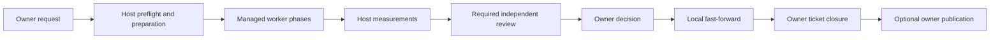

# AWSF — Agentic Workflow Software Factory

[](https://github.com/santiagoms2404/agentic-workflow-software-factory/actions/workflows/ci.yml)

A single-operator software factory for AI coding agents. The host controls
execution, checks the evidence and records what happened. Models propose and
build. The owner decides what lands and what is published.

**Pre-alpha.** The factory can plan, build, test, review, locally land and publish
source. This does not establish unattended delivery, deployment, monitoring or
completion of the broader personal-AI vision. The [v3 spine](specs/awsf-v3-plan.html)
and its deep plans are the development record. Read their earned markers rather
than inferring completion from a feature's presence in the code.

The [whole-project assessment](docs/whole-project-assessment.html) evaluates the
remediation at `057370d`, with an [evidence appendix](docs/whole-project-assessment-evidence.html).
It distinguishes classified findings from fixed findings, archived full-suite
results from fresh targeted checks, and software correctness from useful delivery.
It is a revision-bound assessment, not a live status page.

## Start here

| Need | Source |
|---|---|
| Install and verify the checkout | [Install and usage](#install-and-usage), then [Verifying these claims](#verifying-these-claims) |
| Understand the owner workflow | [Driving the factory](docs/cheatsheet.html) |
| Drive through Marimba | [Operating contract](docs/driving/marimba/CONTRACT.md), [setup](docs/driving/marimba/README.md), then [/prime-awsf](docs/driving/commands/prime-awsf.md) |
| Find current documentation versus historical evidence | [Documentation map](docs/README.md) |
| Understand scope and direction | [v3 intent](specs/awsf-v3-intent.md) and [v3 spine](specs/awsf-v3-plan.html) |
| Change this repository | [AGENTS.md](AGENTS.md) |

The HTML guides open locally in a browser. GitHub normally displays their source.
Historical plans may require their diagram dependencies. The cheatsheet and
assessment reports are self-contained.

## What the host owns

AWSF combines a task lifecycle with a typed phase engine. A workflow fixes the
phase sequence. Each phase returns a runtime-validated envelope, and the host
checks its claims against files, Git and configured quality commands.



This is the delivery sequence, not the complete state machine. Read
[`task-machine.ts`](core/src/state/task-machine.ts),
[`guards.ts`](core/src/state/guards.ts) and
[`awsf next`](core/src/cli/commands/next.ts) for legal edges and implemented next
steps. A declared machine edge does not by itself establish an executable CLI
path. The cheatsheet's state and edge lists are checked against the source.

### Evidence and authority

- **The journal is authoritative.** Status and SQLite are projections. Rebuild
  reconstructs database views from retained records and preserves the previous
  database. It is a write operation, not a diagnostic read.
- **Registration precedes provider execution.** The transport broker holds the
  launcher until the durable registration barrier acknowledges the process.
- **Success must be earned.** A producer's success claim is distinct from the
  host's gate measurements and from the owner's acceptance.
- **The host owns Git during managed execution.** Workers edit within their
  granted scope. The host creates and checks candidate commits. Landing is a
  separate owner-authorized local fast-forward.
- **Publication is separate.** The one authorized push path acts on an already
  landed revision. No force-push or remote-branch deletion is permitted.
- **Cleanup is narrowly bounded.** `awsf gc` lists only. The exact lock-release,
  private-temporary and failed-admission rollback exceptions are in invariant 8
  of `AGENTS.md`. They authorize no general cleanup of user work or refs.

A configured command passing is evidence about that command on that candidate.
It is not proof that the requested behavior is correct, or that every relevant
check was configured.

## Install and usage

Use Node 22.12 or newer in a checked-out repository. The root npm scripts are the
canonical entry points. `just` is an optional wrapper.

```bash
npm install
npm run lint
npm run typecheck
npm test
npm run dash:build
npm run awsf -- doctor
npm run awsf -- workflows
npm run awsf -- routes list
```

Installation can change local dependency state. Inspect unexpected tracked
changes before continuing. `doctor` reports findings and never repairs them.
A nonzero diagnosis is a reason to investigate, not permission to delete a lock
or change retained evidence.

For a separate project, `awsf init` creates its starter configuration and catalog.
`awsf project register` binds catalog repository IDs to machine-local paths.
The committed catalog and local placement have separate ownership. Read the
command's usage and the target project's policy before creating or registering it.

### Fixture execution without provider quota

`npm test` exercises captured-provider journeys without provider accounts or
paid model calls. Explicit fixture execution uses `--stub true` on both
`start` and `run`. It is marked as fixture evidence and cannot establish a real
journey, independent review or landing authorization. Do not pass off a stub run
as a successful production delivery.

### Preparing real work

Use the [preflight cookbook](docs/driving/skills/awsf/cookbooks/preflight_a_task.md).
Resolve the request against the repository, choose a recipe that matches its
risk, and bind the plan and ticket when the work belongs to a registered plan.
For a non-exempt writing task, the sequence includes:

```bash
npm run awsf -- new TASK "Ask: <outcome>
Where: <allowed paths>
Done means: <observable acceptance>
Out of scope: <excluded work>" --workflow build
npm run awsf -- preflight TASK --where core/src/example.ts
# Owner: inspect the preflight and confirm the exact request and paths.
npm run awsf -- confirm TASK
npm run awsf -- start TASK
# Owner: invoke run personally. Marimba must not invoke it.
npm run awsf -- run TASK
npm run awsf -- status TASK --evidence
```

Replace the placeholders and choose actual paths. Do not submit this example as
a task. A workflow fixes its tier. An explicit mismatched `--tier` is refused.
The preflight measures readiness, including request agreement, write boundaries,
prior evidence, baseline gates and closure obligations. Confirmation records
only the owner's attested field. `start` rechecks freshness.

For plan work, `new --plan STEM --ticket ID` seals the selection. A shift selects
whole milestones with `--milestone` instead. A small plan-free task can select
one flat light ticket. `awsf close` updates earned markers and matching ticket
states together after landing. Never flip them by hand to clear a refusal.
Close before publishing. The current closure implementation also accepts
`PUBLISHED`, but its agreement with the sealed-attempt policy remains an explicit
assessment concern, not an invitation to rely on that order.

## Marimba and the owner boundary

Marimba prepares requests, invokes permitted CLI operations, reads evidence and
explains decisions. It never implements the task, edits managed worktrees,
repairs runtime records, impersonates the owner or launches untracked workers.

The canonical owner-act list is
[`owner-acts.mts`](docs/driving/marimba/owner-acts.mts). Both harness guards deny
those acts, including `run`, `seed`, `group apply` and `retry --adopt-as`.
Plain `retry` is different from owner-authorized adoption. A driving session
must not manufacture a replacement task or retry without an agreed remedy.

`run` can execute automatic work without a prompt, but can request an owner
correction decision. Marimba is therefore denied the entire command. The owner
invokes it. Preparing an owner command does not authorize executing it through
a PTY, wrapper, another terminal or another session.

The terminal check is a shape test. The driving boundary is the per-invocation
tool denial, with documented limits: written-text matching, indirection gaps,
over-denial, parser failure behavior and no filesystem sandbox for the driver.
Read the [contract](docs/driving/marimba/CONTRACT.md) before trusting a launcher.
A missing guard is not repaired by a stronger model or by reading a skill.

The group journal retains exact requests, proposals and owner-applied decisions
outside the repository. Its packets and checklists are read-only views, never
execution authority. The [planning skill](docs/driving/skills/marimba-plan/SKILL.md)
describes this distinction. Priming does not survive compaction. The installed
compaction profile reloads its specified driving documents, not runtime state.

## Workflows, routes and budget

Read the enabled catalogue at the point of use:

```bash
npm run awsf -- workflows
npm run awsf -- routes list
```

The catalogue includes analysis, intake, build, reviewed build, full lifecycle,
design-to-plan, plan authoring, milestone shifts and proving-ground workflows.
Some recipes are compiled from selected tickets. Read
[`workflow/catalog.ts`](core/src/workflow/catalog.ts) rather than treating every
recipe as a static list with the same cost.

Tier ceilings, task-scoped spend and correction accounting are defined in
[`state/tiers.ts`](core/src/state/tiers.ts). A continuation and a cold provider
call have different accounting. Corrections are not universally free. A recipe's
phase count is not its call count, and a retry carries prior task spend forward.
`awsf raise` is a bounded, recorded owner grant, not a configuration workaround.

Review independence is provider-level. Two models from one provider are not an
independent pair. Same-provider review needs the owner's explicit, attempt-scoped
`degrade-review` grant. Quota failures never silently choose it.

Owner rework supports eligible T1 and T2 recipes. T2 rework invalidates the old
candidate's assurance and buys fresh gates and review, with headroom checked
before spending. Saved-result and host-effect recovery depend on durable proof.
Interrupted provider turns without the required proof remain refused. Read the
actual recovery diagnosis before recommending `resume`.

## Gates and protected content

Gate identifiers and implementations live in
[`gates/interface.ts`](core/src/gates/interface.ts) and [`gates/`](core/src/gates).
They cover envelope shape, observed changes, write policy, candidate hygiene,
review evidence, configured commands, journey evidence and plan continuity.

`contract_digest` compares candidate artifacts with the host's journal-pinned
production contract set. The candidate's `awsf.contracts.yaml` projection cannot
supply its own authority. A real empty production contract set is distinct from
missing admission evidence.

Protected writes require a separate exact-path, single-use owner grant and OS
isolation. They do not widen the role's write globs or tools, authorize deletion,
approve landing, or let a verifier approve modifications to itself. Final
protected blobs require their own landing confirmation.

A visual binding is machine-local launch context supplied at `start`. Selected
images are digest-bound and rechecked. The visual inspection gate requires the
phase's own successful image-tool reads, not a path in a prompt or an author's
claim. Allowed routes are defined in
[`visual-references.ts`](core/src/workflow/visual-references.ts). A successful
image delivery still does not prove sound visual judgment.

## Dashboard

The Vue/Vite dashboard is served on loopback and reads the projection. It shows
attempts, phases, gates, retained evidence, costs with authority labels, backlog
and group decisions. Archive is the single API write. The UI cannot start,
retry, approve or land work.

```bash
npm run dash:build
npm run awsf -- dash
```

`dash` does not build. Projection degradation must remain visible. A screenshot
or green build proves neither live recovery nor successful delivery.

## Verifying these claims

```bash
npm run lint
npm run typecheck
npm test
npm run dash:build
```

`npm test` runs all five layers and reports each exit status:

| Layer | Purpose |
|---|---|
| `test:unit` | Logic, contracts, architecture fences and document/plan agreement |
| `test:contract` | Shared process-supervisor behavior |
| `test:sim` | Crash cuts, registration, persistence and recovery |
| `test:journeys` | End-to-end paths using captured provider fixtures |
| `test:traps` | Known refusals and their source-deletion mutants |

Report the revision or tested tree, command, exit status and measured totals.
Do not copy old suite totals into a current result. Passing on Linux/WSL does
not establish Darwin or native-Windows behavior. The [v1 portability
matrix](specs/awsf-plan.html#portability) retains the platform-specific evidence.
No native-Windows write parity is claimed.

**Three validation surfaces differ.** The root script runs all five layers.
The configured candidate gates in `awsf.project.yaml` and `awsf.config.yaml`
run unit, types, lint, journeys and traps, not the complete root suite.
[CI](.github/workflows/ci.yml) runs unit, contract, simulation and journeys but
currently omits traps. Do not describe these as interchangeable. Candidate gate
timeouts also matter, particularly the 600-second unit budget on slow storage.
A manual green suite does not waive a managed preflight or its timeout.

## Planning and documentation

The v1 plan records the original completed build. The v2 spine records its
workstreams and their deep plans. The current v3 spine carries the next direction,
including driver checks, traps and ticket closure. Deep plans for v3 W01, W02 and
W03 already exist. Later work needs its own plan and owner decisions.

The registered HTML source owns completion markers. Paired tickets mirror those
markers and carry byte-identical Section B prompts. Completed prompts and dated
assessments remain historical evidence. The [documentation map](docs/README.md)
explains which sources to use for operation, design, scope and past measurements.

## Repository layout

```text
AGENTS.md                 repository invariants and owner amendments
awsf.config.yaml          validated execution configuration
awsf.project.yaml         committed project catalog and repository gates
core/src/state/           pure lifecycle, phase and budget rules
core/src/contracts/       runtime schemas
core/src/workflow/        recipes, compilation and execution
core/src/execution/       broker, supervision and reservations
core/src/persistence/     journal and status storage
core/src/observability/   projection and rebuild
core/src/registry/        project, plan and contract admission
core/src/closure/         ticket closure and plan agreement
core/src/publish/         publication authorization and argv
core/test/                unit, contract, simulation, journeys and traps
dashboard/                loopback observation UI
prompts/                  shipped role prompts
specs/                    intent, plans, canonical build prompts and tickets
docs/                     guides, assessments and driving documentation
records/                  dated pilot and journey evidence
```

Runtime journals, placements, private continuity, raw captures and group records
stay outside Git. Never commit a live status board or copy raw provider output
into documentation. The [evidence map](docs/driving/skills/awsf/references/evidence_map.md)
explains the read boundaries.

## License and attribution

No license file is present. Default copyright applies, with no general permission
to use, copy, modify or distribute granted by this repository. The design draws
on `super-simple-software-factory`, an MIT-licensed © 2026 IndyDevDan project.
Copied code carries its own attribution. The [original architectural
proposal](specs/awsf-architecture-proposal.md) records the source audit and design
lineage.
