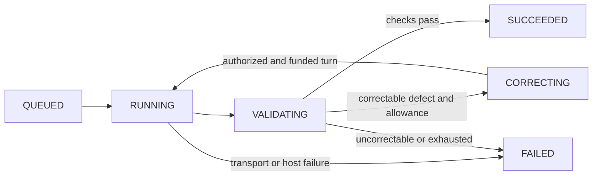
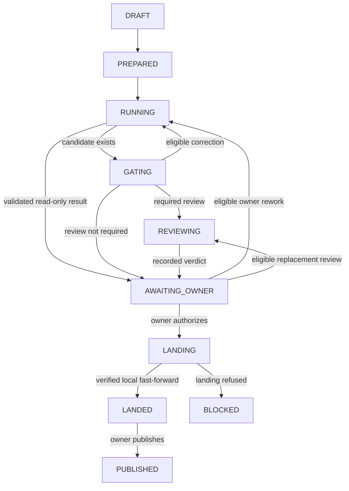

# AWSF — Agentic Workflow Software Factory

[](https://github.com/santiagoms2404/agentic-workflow-software-factory/actions/workflows/ci.yml)

A single-operator software factory for AI coding agents. The host controls
execution, checks the evidence and records what happened. Models propose and
build. The owner decides what lands and what is published.

**Pre-alpha.** The factory can plan, build, test, review, locally land and publish
source. This does not establish unattended delivery, deployment, monitoring or
completion of the broader personal-AI vision. The [v3 spine](specs/awsf-v3-plan.html)
and its deep plans are the development record. Read their earned markers rather
than inferring completion from a feature's presence in the code.

The [whole-project assessment](docs/whole-project-assessment.html) evaluates the
remediation at `057370d`, with an [evidence appendix](docs/whole-project-assessment-evidence.html).
It distinguishes classified findings from fixed findings, archived full-suite
results from fresh targeted checks, and software correctness from useful delivery.
It is a revision-bound assessment, not a live status page.

## Start here

| Need | Source |
|---|---|
| Install and verify the checkout | [Install and usage](#install-and-usage), then [Verifying these claims](#verifying-these-claims) |
| Understand the owner workflow | [Driving the factory](docs/cheatsheet.html) |
| Look up execution rules | [Lifecycle](#task-lifecycle), [recipes](#recipe-reference), [gates](#gates-and-protected-content) and [owner acts](#owner-acts) |
| Configure and observe work | [Configuration](#configuration), [visual references](#visual-references) and [dashboard](#dashboard) |
| Drive through Marimba | [Operating contract](docs/driving/marimba/CONTRACT.md), [setup](docs/driving/marimba/README.md), then [/prime-awsf](docs/driving/commands/prime-awsf.md) |
| Find current documentation versus historical evidence | [Documentation map](docs/README.md) |
| Understand scope and direction | [Owned-platform vision](specs/owned-ai-platform-vision.md), [v3 intent](specs/awsf-v3-intent.md) and [v3 spine](specs/awsf-v3-plan.html) |
| Change this repository | [AGENTS.md](AGENTS.md) |

The HTML guides open locally in a browser. GitHub normally displays their source.
Historical plans may require their diagram dependencies. The cheatsheet and
assessment reports are self-contained.

## What the host owns

An agent's ability to edit a file does not establish permission to commit it,
publish it or declare the task complete. AWSF separates those decisions. The
model supplies structured results. The host measures them and applies lifecycle
rules. The owner accepts the result and authorizes landing and publication.

The architecture joins two ideas documented in the [original proposal](specs/awsf-architecture-proposal.md):
`my-agentic-workflow` supplies guarded task transitions and registered execution,
while `super-simple-software-factory` supplies typed phases, postcondition gates
and an observable execution trace. The task machine decides which lifecycle
transition is legal. The phase engine runs the work inside an executing state.

### Inside a phase

A workflow fixes the phase sequence. Agent phases use a provider. Host phases
compose evidence, create candidates or run commands without a model call. Each
output is validated against its declared runtime schema before downstream phases
may rely on it. A schema-valid result that reports failure is still a failure.



This shows the main phase paths. The [phase machine](core/src/state/phase-machine.ts)
also defines skip, cancellation and abnormal-exit behavior. Schema and eligible
gate defects share a correction allowance. A permission breach, host failure or
transport failure does not become permission to ask the model to try again.
A verified same-session continuation and a cold correction have different call
accounting, so a correction loop is not universally free.

### Task lifecycle

The task remains identifiable across its phases and attempts. Planning, building
and documenting are phases, not extra task states. This keeps lifecycle rules
independent of the selected recipe.



| State | Meaning and next decision |
|---|---|
| `DRAFT` | The request, workflow and configuration snapshot exist. Resolve preflight, scope, selection, budget and owner confirmation before preparation. |
| `PREPARED` | The managed worktree and launch prerequisites exist. Execution has not yet earned a result. |
| `RUNNING` | Workflow phases are executing. Read phase and process evidence rather than inferring progress from silence. |
| `GATING` | The host evaluates the candidate and required quality evidence. Only eligible corrections can return to work. |
| `REVIEWING` | Required review is being obtained or resolved. A review verdict cannot move canonical Git by itself. |
| `AWAITING_OWNER` | The result is ready for an owner decision. Read-only results have no candidate to land. Writing results still need the required journey and landing evidence. |
| `LANDING` | The owner's landing intent is durable. Recovery must reconcile actual Git state before declaring success. |
| `LANDED` | The candidate was incorporated locally. Ticket closure and optional publication remain separate acts. |
| `PUBLISHED` | Publication is recorded and the attempt is sealed. This is source publication, not deployment. |
| `BLOCKED` | A recorded reason stopped the attempt. Diagnose it before a retry, which creates another attempt and carries task spend forward. |
| `CANCELLED` | An explicit owner cancellation ended a cancellable attempt. It does not erase its evidence or spend. |

The diagram omits most refusal and cancellation edges. Read
[`task-machine.ts`](core/src/state/task-machine.ts) and
[`guards.ts`](core/src/state/guards.ts) for the complete transition table and
ordered evidence checks. Use `awsf next TASK` for implemented next steps.
A legal machine edge does not by itself establish an executable CLI path.
Timers and a model's recommendation are not lifecycle authority. After landing,
close the selected work before publication using the sequence below.

### Evidence and authority

- **The journal is authoritative.** Status and SQLite are projections. Rebuild
  reconstructs database views from retained records and preserves the previous
  database. It is a write operation, not a diagnostic read.
- **Registration precedes provider execution.** The transport broker holds the
  launcher until the durable registration barrier acknowledges the process.
- **Success must be earned.** A producer's success claim is distinct from the
  host's gate measurements and from the owner's acceptance.
- **The host owns Git during managed execution.** Workers edit within their
  granted scope. The host creates and checks candidate commits. Landing is a
  separate owner-authorized local fast-forward.
- **Publication is separate.** The one authorized push path acts on an already
  landed revision. No force-push or remote-branch deletion is permitted.
- **Cleanup is narrowly bounded.** `awsf gc` lists only. The exact lock-release,
  private-temporary and failed-admission rollback exceptions are in invariant 8
  of `AGENTS.md`. They authorize no general cleanup of user work or refs.

A configured command passing is evidence about that command on that candidate.
It is not proof that the requested behavior is correct, or that every relevant
check was configured.

## Install and usage

Use Node 22.12 or newer in a checked-out repository. The root npm scripts are the
canonical entry points. `just` is an optional wrapper.

```bash
npm install
npm run lint
npm run typecheck
npm test
npm run dash:build
npm run awsf -- doctor
npm run awsf -- workflows
npm run awsf -- routes list
```

Installation can change local dependency state. Inspect unexpected tracked
changes before continuing. `doctor` reports findings and never repairs them.
A nonzero diagnosis is a reason to investigate, not permission to delete a lock
or change retained evidence.

For a separate project, `awsf init` creates its starter configuration and catalog.
`awsf project register` binds catalog repository IDs to machine-local paths.
The committed catalog and local placement have separate ownership. Read the
command's usage and the target project's policy before creating or registering it.

### Fixture execution without provider quota

`npm test` exercises captured-provider journeys without provider accounts or
paid model calls. Explicit fixture execution uses `--stub true` on both
`start` and `run`. It is marked as fixture evidence and cannot establish a real
journey, independent review or landing authorization. Do not pass off a stub run
as a successful production delivery.

### Preparing real work

Use the [preflight cookbook](docs/driving/skills/awsf/cookbooks/preflight_a_task.md).
Resolve the request against the repository, choose a recipe that matches its
risk, and bind the plan and ticket when the work belongs to a registered plan.
For a non-exempt writing task, the sequence includes:

```bash
npm run awsf -- new TASK "Ask: <outcome>
Where: <allowed paths>
Done means: <observable acceptance>
Out of scope: <excluded work>" --workflow build
npm run awsf -- preflight TASK --where core/src/example.ts
# Owner: inspect the preflight and confirm the exact request and paths.
npm run awsf -- confirm TASK
npm run awsf -- start TASK
# Owner: invoke run personally. Marimba must not invoke it.
npm run awsf -- run TASK
npm run awsf -- status TASK --evidence
```

Replace the placeholders and choose actual paths. Do not submit this example as
a task. A workflow fixes its tier. An explicit mismatched `--tier` is refused.
The preflight measures readiness, including request agreement, write boundaries,
prior evidence, baseline gates and closure obligations. Confirmation records
only the owner's attested field. `start` rechecks freshness.

For plan work, `new --plan STEM --ticket ID` seals the selection. A shift selects
whole milestones with `--milestone` instead. A small plan-free task can select
one flat light ticket. `awsf close` updates earned markers and matching ticket
states together after landing. Never flip them by hand to clear a refusal.
Close before publishing. The current closure implementation also accepts
`PUBLISHED`, but its agreement with the sealed-attempt policy remains an explicit
assessment concern, not an invitation to rely on that order.

## Marimba and the owner boundary

Marimba prepares requests, invokes permitted CLI operations, reads evidence and
explains decisions. It never implements the task, edits managed worktrees,
repairs runtime records, impersonates the owner or launches untracked workers.

The canonical owner-act list is
[`owner-acts.mts`](docs/driving/marimba/owner-acts.mts). Both harness guards deny
those acts, including `run`, `seed`, `group apply` and `retry --adopt-as`.
Plain `retry` is different from owner-authorized adoption. A driving session
must not manufacture a replacement task or retry without an agreed remedy.

`run` can execute automatic work without a prompt, but can request an owner
correction decision. Marimba is therefore denied the entire command. The owner
invokes it. Preparing an owner command does not authorize executing it through
a PTY, wrapper, another terminal or another session.

The terminal check is a shape test. The driving boundary is the per-invocation
tool denial, with documented limits: written-text matching, indirection gaps,
over-denial, parser failure behavior and no filesystem sandbox for the driver.
Read the [contract](docs/driving/marimba/CONTRACT.md) before trusting a launcher.
A missing guard is not repaired by a stronger model or by reading a skill.

### What the guards check

| Fence | Check and limit |
|---|---|
| Delegation-shaped tool names | Denies tools that would create untracked work. Matching uses normalized tool names and explicit observe-or-stop exceptions. It does not inspect arbitrary tool intent. |
| Owner-act command text | Denies literal owner-act invocations, including compound and flagged forms from the canonical list. It reads written text, so indirection and over-denial remain documented limits. |
| Pi lifecycle timeouts | Denies finite controller timeouts and written timeout wrappers around lifecycle execution commands. A controller deadline must not kill execution mid-transition. |

The [shared rules](docs/driving/marimba/marimba-guard-rules.mts) and their harness
bindings are tested together. A session launched without the required settings
has no such protection. These guards do not confine filesystem access and do
not authorize bypassing a refusal. Worker sandbox enforcement is a separate
mechanism with its own reported strength.

### Planning journal and handoff

The group journal retains the owner's permitted exact inputs, proposals and
owner-applied decisions outside the repository. Its records keep provenance and
revision bindings so that a later decision can be traced to the words and scope
it accepted.

| Operation | Purpose |
|---|---|
| `group capture` | Retains the original request or follow-up with its provenance. Unsafe input is refused, and sanitized replacement text must not be called a verbatim copy. |
| `group propose` | Records proposed work and amendments against a group revision. A proposal has an identity and content hash, but no owner approval. |
| `group apply` | Records the owner's decision against the expected proposal and revision. It does not authorize a worker launch or change an attempt. |
| `group inspect`, `group input` | Expose retained source text and its provenance for verification. |
| `group orient`, `group focus`, `group checklist` | Provide bounded views of units, prerequisites, decisions and observed progress. Unknown or stale evidence stays visible. |

Packets and checklists are read-only views, never execution authority. Read the
[planning skill](docs/driving/skills/marimba-plan/SKILL.md) and its
[operations reference](docs/driving/skills/marimba-plan/references/operations.md)
for capture, amendment and handoff rules. Source references survive a handoff,
but a new driving session starts a new group rather than silently adopting one
by timing or title.

The controlled [handoff script](docs/driving/marimba/handoff.sh) takes a known
launcher variant and a handoff file. It must not be replaced with a composed
command that omits the guard. A handoff names facts and sources, pending owner
decisions and unverified claims. It does not grant its successor new authority.

For continuing sessions, the repository provides a
[compaction profile](docs/driving/marimba/compaction/profile.json) for the
separately installed extension. It reloads the driving skills and selected
references. It does not restore live task state. After compaction, read current
runtime evidence and rerun source-derived lookups when needed. No workflow,
gate or transition depends on that extension being installed.

## Owner acts

The following is a practical reference to the
[canonical owner-act list](docs/driving/marimba/owner-acts.mts), not permission
for a driving session to execute it. Arguments and eligibility depend on the
command and the retained attempt. Present the evidence before asking for an act.

| Act (after `awsf`) | Effect and boundary |
|---|---|
| `confirm` | Attests the exact request and paths from the recorded preflight. Changed request text or path selection needs fresh confirmation. Base freshness is measured separately. |
| `run` | Executes prepared work and can request an owner correction decision. The owner invokes the entire command personally. |
| `resume` | Continues an eligible quota pause or recovers a result or host effect with durable proof. Unknown interrupted outcomes are not silently repeated. |
| `rework` | Re-enters an eligible T1 or T2 candidate with a concrete defect. It creates a new candidate and fresh assurance, including review where required. |
| `review` | Replaces an eligible structurally unevidenced review without changing the candidate. Disliking a properly evidenced verdict is not eligibility. |
| `degrade-review` | Grants explicit same-provider review for one eligible attempt. It records reduced independence and does not change project-wide routing. |
| `raise` | Adds a bounded number of calls to a live task with a recorded reason. It neither spends them immediately nor bypasses other admission checks. |
| `grant` | Authorizes exact protected files for one phase and one use. It does not widen role write globs, grant deletion or approve landing. |
| `journey` | Records the owner's end-user validation against the exact candidate revision. Passing configured commands is not a substitute. |
| `land` | Authorizes a verified local fast-forward through durable landing intent. It never pushes. |
| `close` | Records earned plan or light-ticket completion after landing. Matching plan markers and ticket states change together in a checked closure commit. |
| `publish` | Pushes an eligible landed revision to its configured destination and seals publication. It never force-pushes or deletes a remote branch. |
| `cancel` | Ends an eligible active attempt explicitly, retaining its evidence and task spend. |
| `attribute` | Records an owner's cause classification for a blocked attempt without reopening it. Later attribution can supersede the earlier classification. |
| `prove` | Creates a replay of a frozen proving-ground item on an explicit route. A replay measures a route and cannot be landed as delivery. |
| `seed` | Starts a new task from an exact committed candidate of a sealed attempt. It transfers no source approvals or spend, and requires a new build with fresh gates, review, journey and landing approval. |
| `group apply` | Accepts a revision-bound planning proposal. Planning approval and execution approval remain separate. |
| `retry --adopt-as` | Adopts an eligible sealed candidate into a new continuation without another builder call. Fresh gates, review, journey and landing approval remain required. Plain retry does not perform adoption. |

Rework, replacement review and retry solve different problems. Rework changes
the candidate. Replacement review preserves it and replaces only eligible review
evidence. Retry starts another attempt after a stop. Read `awsf next TASK` and
[blocked-attempt guidance](docs/driving/skills/awsf/cookbooks/read_a_blocked_attempt.md)
before choosing among them.

## Workflows, routes and budget

Read the enabled catalogue at the point of use:

```bash
npm run awsf -- workflows
npm run awsf -- routes list
```

Choose the evidence the work needs before choosing the cheapest route. A
recipe that fits the budget can still be wrong for the requested change. The
[workflow catalogue](core/src/workflow/catalog.ts) contains both fixed recipes
and compilers whose input selection determines the actual phase sequence.

### Recipe reference

Provider calls below are minimums for one successful pass, excluding corrections
and recovery. Host phases add no provider calls. The live catalogue supplies the
effective ceiling and correction headroom under the project's configuration.

| Workflow | Tier | Minimum calls | Result and appropriate use |
|---|---|---|---|
| `scout` | T0 | 1 | Read-only survey with concrete source locations. Use when the relevant code or behavior is not yet understood. |
| `plan` | T0 | 1 | Read-only implementation and verification sequence. Use to evaluate the approach before building, without creating a registered plan set. |
| `intake` | T0 | 1 | Creates or refines one scoped ticket with observable acceptance. This is a bounded ticket-writing route, not general code mutation. |
| `build` | T1 | 1 | A bounded implementation, host-created candidate and configured quality evidence. Use when the request already contains the necessary facts. |
| `plan-build-test` | T1 | 2 | A plan followed by implementation and host checks. Use when sequencing matters but the change does not require task-level independent review. |
| `build-review` | T2 | 2 | A candidate, host quality evidence and opposite-provider review. Use for consequential changes needing a second opinion. |
| `simple-sdlc` | T2 | 4 | Plan, build, test, document, rerun configured tests, then review. The final checks cover the candidate after documentation changes. |
| `design-to-plan` | T1 | 3 | Repository evidence, design, independent architecture review, planning and host admission of a new plan set. Architecture review is an ordinary phase, distinct from T2 candidate review. |
| `plan-author` | T2 | 2 | Authors a new deep-plan set for one sealed spine ticket, then host admission, gates and cross-provider review. The author writes private output, not existing repository files. |
| `shift` | T2 floor | Selected tickets + 1 | Compiles selected whole milestones into ordered brief/build/test units with one final review and owner decision. Its phase list is selection-bound. |
| `prove` | T1 build / T2 review | 1 | Replays a frozen build or review item on an explicit route. This produces comparison evidence, never a deliverable to land. |

`plan-author`, `shift` and `prove` must be compiled from their recorded inputs.
They cannot be silently selected as the project's default workflow. A changed
ticket or replay item is a binding change, not harmless new context for recovery.
See [plan authoring](core/src/workflow/recipes/plan-author.ts),
[shift compilation](core/src/workflow/shift/compile.ts) and
[replay compilation](core/src/workflow/prove/compile.ts).

### Risk and correction budget

The defaults below come from [`state/tiers.ts`](core/src/state/tiers.ts).
Configuration may choose bounded ceilings, and a recorded owner grant may raise
a task's effective ceiling. Neither changes the risk classification of the work.

| Tier | Intended work | Default call ceiling |
|---|---|---|
| T0 | Read-only analysis or the separately scoped intake recipe. | 1 |
| T1 | Localized, reversible mutation. | 3 |
| T2 | Security, process control, persistent data, cross-component or weakly-tested work, with required independent review. | 5 |

A call is a counted provider invocation, not a currency amount. Outstanding
reservations count alongside spent calls, and reservation precedes launch.
Task spend carries across ordinary retries so repeated failure cannot reset the budget.
Per-act grant limits and the overall maximum are enforced in the pure tier
module, not left to a prompt or an editable configuration bound.

`corrections fundable` reports the margin above a recipe's minimum calls. It does
not guarantee that every defect can be corrected, or that allowance, continuity
and later review headroom are available. The phase's correction allowance and
the task's call ceiling are separate checks. A verified same-session correction
can be call-neutral. A cold correction needs another reservation. Permission
breaches and transport failures do not become correctable output defects.

When headroom is insufficient, prepare `awsf raise TASK --calls N --reason WHY`
for the owner while the task can still receive it. Do not change configuration
mid-attempt or select a lower-risk recipe merely to avoid the required checks.
The [workflow and tier cookbook](docs/driving/skills/awsf/cookbooks/choose_the_workflow_and_tier.md)
explains the judgment behind the choice.

### Route selection and review

Review independence is provider-level. Two models from one provider are not an
independent pair. Same-provider review needs the owner's explicit, attempt-scoped
`degrade-review` grant. Quota failures never silently choose it.

Owner rework supports eligible T1 and T2 recipes. T2 rework invalidates the old
candidate's assurance and buys fresh gates and review, with headroom checked
before spending. Saved-result and host-effect recovery depend on durable proof.
Interrupted provider turns without the required proof remain refused. Read the
actual recovery diagnosis before recommending `resume`.

## Gates and protected content

A gate records individual checks and their evidence, not just a green boolean.
The following reference covers the identifiers in
[`gates/interface.ts`](core/src/gates/interface.ts). Attachment and timing depend
on the phase and workflow. Some evidence checks run before a provider launch,
while output and candidate checks run after the relevant result exists.

### Output shape

| Gate | What it checks |
|---|---|
| `envelope_valid` | Runtime schema validity and explicit producer success. Review finding completeness also checks scope, observed mechanism and consequence without asking the reviewer to soften its verdict. |
| `artifacts_exist` | The host can observe every declared artifact. An empty artifact list does not invent an obligation to create a file. |
| `files_non_empty` | Declared artifacts exist and contain bytes. |
| `json_parses` | Declared `.json` artifacts parse from observed file contents. A model's assertion that its JSON is valid is insufficient. |

### Claims against Git

| Gate | What it checks |
|---|---|
| `diff_matches_claims` | Exact set equality between declared changed paths and the host-observed diff. Undeclared changes and invented changes both fail. |
| `head_advanced` | A host commit exists and its HEAD differs from the base. |
| `candidate_hygiene` | Candidate whitespace/conflict-marker checks and clean-tree evidence. This host check is not an optional configured quality command. |

### Write policy

| Gate | What it checks |
|---|---|
| `no_protected_paths` | Changed paths satisfy protected-path policy or an exact host-issued capability. Invalid paths or policy fail rather than being treated as unprotected. |
| `writes_within_globs` | Every changed path is within the role's permitted write globs. A protected grant does not replace this check. |
| `risk_tier_sufficient` | The attempt tier covers the configured risk of the planned or actually changed paths. A safe-looking plan cannot authorize a riskier implementation. |

### Review integrity

| Gate | What it checks |
|---|---|
| `review_evidence_present` | Host-composed intent, base, candidate and review context are present and bound correctly. Launch preparation and actual delivery are checked separately. |
| `verdict_consistent` | The reviewed SHA, verdict, findings and declared evidence limitations agree. An accepting verdict cannot hide blocking findings, and omitted diff evidence must be accounted for. |
| `architecture_verdict_consistent` | The architecture review names the design it judged, resolves finding subjects and declares limitations consistently with its verdict. |
| `architecture_review_clear` | The host's plan context carries the exact design commitments and an accepting review without blocking findings. It does not re-prompt a reviewer to approve an unchanged design. |

### Measured execution and delivery

| Gate | What it checks |
|---|---|
| `commands_pass` | The host ran the configured argv against the exact candidate, with required clean-tree evidence and successful exits. The retained output belongs to that execution. |
| `journey_passes` | The journey ran, passed and names the exact candidate revision. These are separate checks. |
| `design_evidence_present` | Each catalog repository has resolved revision evidence, with no missing, duplicate or unexpected repository identity. |
| `visual_references_inspected` | Every bound frame was observed through successful image-tool delivery in the bound phase's own turns. Another phase's read cannot satisfy it. |

### Plan continuity

| Gate | What it checks |
|---|---|
| `contract_digest` | Candidate contract artifacts and their projection match host-derived, journal-pinned production requirements. |
| `spine_declared` | The design answers the recorded request and declares the invariants and acceptance criteria the plan must preserve. |
| `spine_carried` | Those identified commitments survive into the plan rather than disappearing during planning. |

The candidate's `awsf.contracts.yaml` projection cannot supply its own authority
for `contract_digest`. A genuinely empty admitted contract set is distinct from
missing admission evidence. Similarly, a consistent review record proves neither
that its reviewer found every defect nor that the design will meet user needs.

### Protected writes and isolation

Protected writes require a separate exact-path, single-use owner grant and OS
isolation. They do not widen the role's write globs or tools, authorize deletion,
approve landing, or let a verifier approve modifications to itself. Final
protected blobs require their own landing confirmation.

Read the reported sandbox strength. `os-enforced`, `tool-policy` and
`unavailable` are different guarantees. Tool filtering is not equivalent to OS
isolation. A requested capability can be refused when the available isolation
cannot enforce it. See [path policy](core/src/policy/path-policy.ts),
[the sandbox broker](core/src/policy/sandbox-broker.ts) and
[protected grants](core/src/workflow/protected-grants.ts).

## Configuration

Execution tuning belongs in [`awsf.config.yaml`](awsf.config.yaml). Project
repository identities, plan sources and repository gates belong in the committed
[`awsf.project.yaml`](awsf.project.yaml) catalog. Machine-specific placements
belong in local state. These files have different purposes and should not be
merged into a machine-specific committed configuration.

| Configuration area | Controls |
|---|---|
| `project`, `workflows` | Project identity, default static recipe and enabled workflow vocabulary. |
| `adapters`, `routing` | Declared harnesses, phase-route choices, review policy and quota policy. An enabled adapter still needs runtime availability and admission. |
| `agents` | Each role's model, effort, prompt files, harness continuity, allowed tools and write scope. These are independent controls. |
| `runtime` | Silence/output bounds, process grace and ignored local seed paths. Seed material provisions worktrees and is not a candidate artifact. |
| `gates` | Named executable-plus-argv quality commands and their timeouts. The host records their actual exits. |
| `risk`, `policy` | Path risk, bounded call ceilings, correction allowances, protected paths and protected operations. |
| `observability`, `pricing` | Projection settings and explicitly labeled estimates. They cannot turn missing usage into provider-reported facts. |

The [`awsf/v1` schema](core/src/config/schema.ts) and
[loader](core/src/config/load.ts) reject absolute machine paths, credential-shaped
values, unknown references, duplicate agent names and invalid write/seed paths.
Seed paths must be normalized and nonoverlapping. Call ceilings must be whole
numbers inside the code-defined bounds. Compiled workflows cannot be the default,
and partial adapter/provider route overrides are refused.

`routing.no_fallback` must remain `true`. Current runtime failures do not silently
choose another provider or weaken review. `observability.persist_thinking_text`
must remain `false`. The [effective configuration](core/src/config/effective-config.ts)
is snapshotted and redacted for retained evidence and readouts. Editing the source
configuration later does not silently change the attempt's recorded agreement.

## Visual references

Supply machine-local image bindings at preparation when a phase must make visual
decisions:

```bash
npm run awsf -- start TASK --visual-references /absolute/path/to/binding.yaml
```

The following is an illustrative binding, not a file to commit. Replace the root
and source paths with actual local material before using it:

```yaml
schema: awsf.visual-reference-binding/v1
root: /absolute/path/to/plan-repository
index: specs/design-index.json
digests: design/capture.json
selection:
  frames: [main-screen, detail-screen]
phases: [builder]
```

The documents have distinct roles:

| Document | Required relationship |
|---|---|
| Binding | Names the absolute local root, root-relative index and digest files, selected frames and actual agent phase IDs. It is private launch context. |
| Index | JSON with `version: 1` and `frames: [{ id, image }]`. Its bytes must match the committed Git blob at the reference root's HEAD. Image paths are root-relative. |
| Digests | JSON with `indexSha256` and `images: { FRAME_ID: SHA256 }`. It binds the index bytes and each selected image's bytes. |

A ticket selection can replace `frames`, using
`selection: { plan: PLAN_STEM, ticket: T06 }`. It must match the attempt's registered
plan and resolve through the index's `ticketFrames` mapping. A bare ticket ID is
ambiguous across plans and is not sufficient.

Admission checks real-path containment, duplicate and unknown frames, the
committed index, digest agreement and decoded PNG/JPEG content. The
[visual contract](core/src/contracts/visual-references.ts) bounds a selection to
32 frames, each at most 4 MiB and 2000 pixels per edge. A bad binding is refused
before preparation completes. The full binding stays private, while public
journal evidence records its digest and verified frame facts.

Each bound launch rechecks the source and copies only selected bytes into a
fresh delivery directory outside the worktree. Every turn rechecks delivery,
including corrections. OS-isolated launches mount it read-only. A tool-policy
launch reports its weaker protection rather than claiming the same guarantee.

The admitted model selectors are the measured allowlist `VISUAL_ROUTES` in
[`visual-references.ts`](core/src/workflow/visual-references.ts), not every model
that advertises image support. The route also needs the permitted image-reading
tool. Rework and replacement review refuse bound phases they cannot deliver
instead of silently running them text-only. A path in a prompt, a host-side hash
or a worker's claim does not satisfy the inspection gate. Successful delivery
still does not prove sound visual judgment.

## Dashboard

The Vue/Vite dashboard is served on loopback and reads the projection. It shows
attempts, phases, gates, retained evidence, costs with authority labels, backlog
and group decisions. Archive is the single API write. The UI cannot start,
retry, approve or land work.

```bash
npm run dash:build
npm run awsf -- dash
```

`dash` does not build. Build assets before serving them. The principal views are:

| View | What to inspect |
|---|---|
| Sessions grid | Attempt state, workflow, risk, routes, calls and usage, with filtering, grouping and sorting. An archived card is hidden from a view, not erased from history. |
| Session detail | Actual transitions, phase timing, the candidate and owner-facing result. Select a phase to inspect its retained evidence. |
| Phase drawer | Prompt and envelope rounds, tool events, command output, gate checks and error details. A summary is not a substitute for the underlying record. |
| Backlog | Tickets and registered plan relationships, including spine and deep-plan distinctions. Missing or unreadable plan evidence must not appear as completion. |
| Groups | Captured inputs, proposed scope and applied decisions, distinguishing owner wording from assistant or derived text. |
| Execution canvas | Runs, plans and driving groups with drill-down views. Spatial proximity does not itself prove a dependency or authorization. |
| Route metrics | Ledger, matrix, run and frontier views of recorded route outcomes. Comparisons depend on evidence scope and attribution, not just token totals. |
| Failure readouts | Classification into refusal, review, quota, harness or unclassified. An unknown error stays unclassified rather than being guessed into a model failure. |

Usage, cost and sandbox labels carry their evidence authority. Provider-reported
usage, partial usage, catalog estimates and unavailable values are not
interchangeable. Subscription pricing is not a measured invoice for the run.
The reasoning-text configuration forbids persistence even when live display is
available. Do not infer retained reasoning from other stored phase evidence.

Polling uses live/idle cadences, bounded retry backoff and refresh on renewed
attention. The degradation banner must remain visible when the projection is
behind or unavailable. A screenshot or green build proves neither live recovery
nor successful delivery. The [API routes](core/src/api/routes.ts) and
[dashboard sources](dashboard/src) define the observation surface.

## Verifying these claims

```bash
npm run lint
npm run typecheck
npm test
npm run dash:build
```

`npm test` runs all five layers and reports each exit status:

| Layer | Purpose |
|---|---|
| `test:unit` | Logic, contracts, architecture fences and document/plan agreement |
| `test:contract` | Shared process-supervisor behavior |
| `test:sim` | Crash cuts, registration, persistence and recovery |
| `test:journeys` | End-to-end paths using captured provider fixtures |
| `test:traps` | Known refusals and their source-deletion mutants |

Report the revision or tested tree, command, exit status and measured totals.
Do not copy old suite totals into a current result. Distinguish a measured test
result from a platform guarantee or a completed user journey.

**Three validation surfaces differ.** The root script runs all five layers.
The configured candidate gates in `awsf.project.yaml` and `awsf.config.yaml`
run unit, types, lint, journeys and traps, not the complete root suite.
[CI](.github/workflows/ci.yml) runs unit, contract, simulation and journeys but
currently omits traps. Do not describe these as interchangeable. Candidate gate
timeouts also matter, particularly the 600-second unit budget on slow storage.
A manual green suite does not waive a managed preflight or its timeout.

## Planning and documentation

The v1 plan records the original completed build. The v2 spine records its
workstreams and their deep plans. The current v3 spine carries the next direction,
including driver checks, traps and ticket closure. Deep plans for v3 W01, W02 and
W03 already exist. Later work needs its own plan and owner decisions.

### Artifact responsibilities

| Artifact | Responsibility |
|---|---|
| Spine plan | Defines workstreams, scope and ordering gates. A workstream is not implementation-ready merely because its name appears here. |
| Deep plan | Breaks one workstream into milestones, tasks, acceptance checks and owner decisions. |
| Build prompts | Supplies the canonical Section B execution prompt for each task. |
| Ticket set | Re-cuts those prompts with stable IDs, dependencies and state. It is not a separately editable version of the plan. |
| Amendments | Records dated scope changes, owner decisions and completed evidence without rewriting earlier history. |

The registered HTML source owns completion markers. Paired tickets mirror those
markers and carry byte-identical Section B prompts. Completion changes together,
never in a later synchronization commit. The plan is resolved through its
registered source, not guessed from a neighboring directory. Flat light tickets
are the explicit plan-free exception and close through their dedicated path.

### Direction and limits

| Generation | Intended contribution |
|---|---|
| [v1](specs/awsf-plan.html) | Established the lifecycle, execution kernel, adapters, gates, owner controls, observation UI and adoption-pilot evidence. |
| [v2](specs/awsf-v2-plan.html) | Extended the factory toward registered projects, design-to-plan, prompt composition, quota readouts, publication, shifts and route measurement. Declared optional or deferred work must be read from its earned markers. |
| [v3](specs/awsf-v3-plan.html) | Moves driving procedure into the host, with reliability and records before greater autonomy, then routing, validation, context, readiness and later deployment/monitoring work. The plan is a direction and acceptance contract, not a claim that all of this ships. |

The [owned-platform vision](specs/owned-ai-platform-vision.md) is broader: a
customer-controlled personal AI environment that can create, improve, retain and
reuse useful tools, with permitted knowledge and context-specific authority.
AWSF contributes governed software creation and verification. Marimba supplies
the intended interaction and coordination layer. Learning, shared installations,
collaboration and physical devices are product directions, not proof of completed
integration in this repository.

A feature's proposed value should connect to a concrete user outcome in that
vision and then to explicit plan scope and acceptance evidence. A brainstorm or
accepted product direction grants no runtime permission and adds no workstream
by itself. In v3, reliability precedes expanded autonomy and landing remains an
owner act. Deployment, monitoring and future product surfaces require their own
planned implementation and verification.

Completed prompts and dated assessments remain historical evidence. The
[documentation map](docs/README.md) explains which sources to use for operation,
design, scope and past measurements.

## Repository layout

```text
AGENTS.md                 repository invariants and owner amendments
awsf.config.yaml          validated execution configuration
awsf.project.yaml         committed project catalog and repository gates
core/src/state/           pure lifecycle, phase and budget rules
core/src/contracts/       runtime schemas
core/src/workflow/        recipes, compilation and execution
core/src/gates/           measured postconditions and evidence checks
core/src/preflight/       request agreement and readiness checks
core/src/policy/          path, tool, redaction and sandbox policy
core/src/execution/       broker, supervision and reservations
core/src/adapters/        provider protocols and fixture adapters
core/src/persistence/     journal and status storage
core/src/planning/        group inputs, proposals and decisions
core/src/observability/   projection and rebuild
core/src/registry/        project, plan and contract admission
core/src/closure/         ticket closure and plan agreement
core/src/publish/         publication authorization and argv
core/src/api/             loopback read API and archive action
core/test/                unit, contract, simulation, journeys and traps
dashboard/                loopback observation UI
prompts/                  shipped role prompts
specs/                    intent, plans, canonical build prompts and tickets
docs/                     guides, assessments and driving documentation
records/                  dated pilot and journey evidence
```

Runtime journals, placements, private continuity, raw captures and group records
stay outside Git. Never commit a live status board or copy raw provider output
into documentation. The [evidence map](docs/driving/skills/awsf/references/evidence_map.md)
explains the read boundaries.

## Governance and portability

[AGENTS.md](AGENTS.md) governs sessions working on this repository. Its
architecture fences under [meta-tests](core/test/unit/meta) enforce boundaries
including pure state logic, the sole shipped child-process import site, bounded
SQLite writers, dependency allowlists, publication restrictions and credential
exclusion. Test-fixture process creation is explicitly outside the shipped-code
child-process fence. Read the invariant's scope before interpreting a search hit.

Plan markers are earned only for completed work. Owner identity is mandatory for
Git authorship and committer identity. Runtime records stay outside Git. The
Delegate's declared authority requires an owner-granted, scoped, revocable lease
and cannot turn a model response into a lifecycle reason or owner approval.
These are constraints, not evidence that every future delegated feature exists.

Process supervision has a shared interface and platform-specific implementations.
A host that cannot establish process-tree facts must report that limitation.
Use the [portability matrix](specs/awsf-plan.html#portability) for dated evidence
from the actual target platform. Linux/WSL test success cannot close a Darwin or
native-Windows claim, and no native-Windows write parity is claimed.

## License and attribution

No license file is present. Default copyright applies, with no general permission
to use, copy, modify or distribute granted by this repository. The design draws
on `super-simple-software-factory`, an MIT-licensed © 2026 IndyDevDan project.
Copied code carries its own attribution. The [original architectural
proposal](specs/awsf-architecture-proposal.md) records the source audit and design
lineage.
